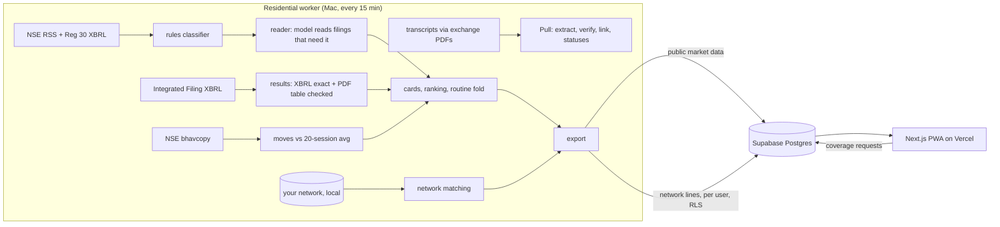

# FINN: your portfolio, briefed

A mobile-first investor agent for Indian equities, built for the ENAM Holdings Founding AI Engineer build challenge.

**Live:** https://finn-red.vercel.app (open it on a phone; each visitor gets a private copy of the demo network) · **Writeup:** [`docs/WRITEUP.md`](docs/WRITEUP.md) · **Decision log:** [`docs/DECISIONS.md`](docs/DECISIONS.md)

FINN has one opinion: **an investor should be briefed, not fed.** Instead of an alert per filing, FINN writes a ranked *edition* of your portfolio that folds the routine and ends.

| Layer | What you see | What's underneath |
|---|---|---|
| **Push: The Edition** | Alerts (each threshold crossing, with the rule that fired), then up to three lead items, a counted "worth a look", one folded row of routine filings, *end of edition*. Last 24 hours by default; 3d / 7d / 30d / since last visit. "What counts" sets thresholds and which announcement types matter. "Brief me · 60s" reads it aloud. | NSE RSS + Reg 30 XBRL, rules-first classification (100% material recall on a held-out set), the event read from the filing overrides vague NSE subjects, seniority-ranked people, results tables accepted only when the statement's own identities hold, EOD moves from the official bhavcopy, explained by the filing that preceded them or said to be unexplained. |
| **Pull: the Promises ledger** | For any NSE ticker: every promise management made on the last four earnings calls, a glyph per call (● delivered ◐ partly ○ missed ↻ revised — went silent ◌ period ended), the verbatim quote with its transcript page, the latest filed quarter beside a running full-year target, the latest checked results table, and the people who'd know. Nifty 50 pre-built; any other ticker on request. | The model transcribes statements in overlapping windows; **code** verifies each quote against its page (cite-or-drop, quotes shown as the page's own text), requires every figure to be printed in its quote, links statements into promises, and computes every status. Revisions come from comparing values, dates and target periods, never from management's "on track". |
| **Network** | Never a tab. One quiet line on a card, a "best placed, and why" on the card page, and a plain answer to "has anyone worked or studied with them?" (including "no one"). The search box also asks your own network: a name, a theme, an employer, a school. | Deterministic, local matching. Relevance before warmth: a role there that fits the event, or expertise in the filing's subject, first. Overlaps dated from the filing's own words. Wording follows evidence. Insiders flagged and never suggested for an unexplained move. Contact data never goes to any model. |

## Architecture



Why a residential worker: NSE and BSE refuse or time out datacenter requests (measured 3 times, `docs/research/00-hands-on-experiments.md` E5, E8, E12). The worker uses only files NSE publishes for download, with an honest User-Agent, polite spacing, a disk cache, and no retries after a refusal. In production a licensed feed (NSE Corporate Data) replaces it.

## Measured so far

| What | Result | Where |
|---|---|---|
| Source audit of every displayed number (independent reviewer, cached PDFs and bhavcopies) | before fixes: 6 of 18 results cards wrong or misleading, 6 moves falsely "unexplained"; all 33 move cards recomputed exactly. Fixed and re-audited: see E29 / E30 | `docs/research/00-hands-on-experiments.md` |
| Results tables (18 portfolio results PDFs) | 16 shown, every one passing the statement's own identities (2 also equal the Integrated Filing XBRL exactly); SBI and Sun Pharma withheld | E25, E29 |
| Rules classifier, **held-out** (80 later company filings, labelled before running the rules) | **material recall 36/36 = 100%**, category 92%, routine folded 83% (7 routine items over-surfaced, none missed) | `uv run python -m evals.eval_classifier --heldout` |
| Guidance extraction vs 84 hand-labelled statements (8 transcripts) | recall 80%, precision 61% strict; a hand check of unmatched predictions puts effective precision near 80% | `worker/evals/eval_extraction.py`, E24 |
| Quote verification | 84/84 gold quotes found on the cited page; 84/84 pages corrected when offset by one; quotes shown are the page's own text | `worker/tests/test_pull.py`, E17, E29 |
| Ledger verdicts (third audit, E31) | quotes 1,575/1,575 verbatim, yet most of 53 settled rows were not comparable (analyst figures, the reported quarter settled against itself, wrong periods). Now settled only on a comparable, management-stated outcome: 2 of ~1,300 rows; the rest stay open, revised, silent or ended-unproven | E31, `worker/tests/test_pull.py` |
| Card links (third audit) | the SBI alert opened a missing card; now every move session has its own card: 145 live links checked, 0 broken | E31 |
| Promise linking without a model | pairwise precision 0.88 / recall 0.70 (BEL), 0.75 / 0.67 (Deepak Nitrite); model-assisted linking was noisier, so it is off | `worker/evals/eval_linking.py`, E26 |
| Row-level security, live against Supabase | 14/14: two visitors can't see each other's network; public data read-only (probed with a no-op write); no contact name in the public payload; visitors can't write private rows and can't see who requested coverage (migration 003) | `uv run python -m evals.rls_check` |
| Model spend for the whole build | see the writeup; Gemini free tier first for everything ($0); OpenAI ~$0.005 per call only when Gemini fails | `llm_calls` table |
| Tests | 133 worker tests | `uv run pytest` |

## Run it

```bash
# worker (Python 3.12, uv)
cd worker
uv sync
uv run python -m finn_worker.run backfill   # 30 days of filings for the portfolio
uv run python -m finn_worker.run once       # one cycle: feeds, results, read, export, sync
uv run pytest

# app (Node 22+)
cd web
npm install
npm run dev                                 # http://localhost:3000, reads ../data
```

Keys go in `.env` (see `.env.example`); nothing secret is committed. Without Supabase the app reads the worker's local export; without a model key, filings that need reading show an honest "pending" state.

## Repository

```
config/        portfolio.json (18 NSE stocks), network.json (synthetic contacts)
worker/        ingest, classify, XBRL, results, prices, reader, pull, network, export, sync, tests, evals
web/           Next.js 16 PWA: Edition, company dossier + ledger, person page, settings
supabase/      schema with row-level security
docs/          PLAN.md, DECISIONS.md (decision log), research/ (experiments, competitors, data sources, design, architecture, gold set)
```

## Data and licensing

Prototype for evaluation only. It uses NSE's published download files (RSS, XBRL, filing PDFs, bhavcopy) and the exchange PDFs that screener.in links to (link discovery only). Exchange data is not redistributed in this repo. A real deployment would license NSE Corporate Data (₹10.6 lakh/yr realtime) or a vendor such as TrueData or Accord. The network is synthetic. Real networks would come only from the investor's own consented imports (LinkedIn `Connections.csv`, Google Contacts, CRM), never scraping.
