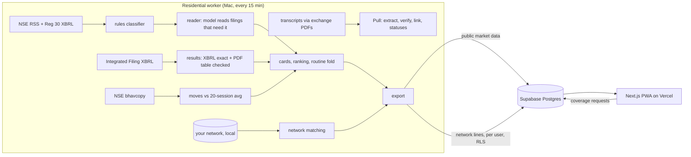

# FINN: your portfolio, briefed

A mobile-first investor agent for Indian equities, built for the ENAM Holdings Founding AI Engineer build challenge.

**Live:** https://finn-red.vercel.app (open it on a phone; each visitor gets a private copy of the demo network) · **Writeup:** [`docs/WRITEUP.md`](docs/WRITEUP.md) · **Decision log:** [`docs/DECISIONS.md`](docs/DECISIONS.md)

FINN has one opinion: **an investor should be briefed, not fed.** Every Indian tool sends one ping per filing. FINN writes an *edition* that ranks, folds the routine, and ends.

| Layer | What you see | What's underneath |
|---|---|---|
| **Push: The Edition** | Three lead items, a counted "more worth a look", one folded row of routine filings, *end of edition*. A window chip (24h / 3d / 7d / 30d). "What counts" sets price/volume thresholds and which announcement types matter. "Brief me · 60s" reads it aloud. | NSE RSS + Reg 30 XBRL, rules-first classification (100% material recall on a hand-labelled sample), same-day filings grouped into one card, results checked against Integrated Filing XBRL, EOD moves from the official bhavcopy. A move with no filing says so instead of guessing a cause. |
| **Pull: the Promises ledger** | For any NSE ticker: every promise management made on the last four earnings calls, a glyph per call (● delivered ◐ partly ○ missed — went silent ↻ revised), the verbatim quote with its transcript page, and where the evidence comes from. | One model call per transcript transcribes statements; **code** verifies each quote against its page (cite-or-drop), links statements into promises, and computes every status. Revisions are detected by comparing values and dates, never from management's "on track". |
| **Network** | Never a tab. One quiet line on a card: *Rhea Kapoor was Head of Strategy at Titan, 2014–21 · last spoke 8 wk ago.* A person page explains tie strength term by term and drafts a note. | Deterministic, local matching: alumni > board members > domain experts > second-degree paths. Wording follows evidence ("worked together" only when dates overlap). Current employees are flagged as insiders and never suggested for an unexplained price move. Contact data never goes to any model. |

## Architecture



Why a residential worker: NSE and BSE refuse or time out datacenter requests (measured 3 times, `docs/research/00-hands-on-experiments.md` E5, E8, E12). The worker uses only files NSE publishes for download, with an honest User-Agent, polite spacing, a disk cache, and no retries after a refusal. In production a licensed feed (NSE Corporate Data) replaces it.

## Measured so far

| What | Result | Where |
|---|---|---|
| Rules classifier, **held-out** (80 later company filings, labelled before running the rules) | **material recall 37/37 = 100%**, category 92%, routine folded 85% (6 routine items over-surfaced, none missed) | `uv run python -m evals.eval_classifier --heldout` |
| Rules classifier, tuning sample (120 filings) | category 92% → 94%, material recall 98% → 100%, routine folded 64% → 94% (before → after tuning on this sample) | `uv run python -m evals.eval_classifier` |
| Guidance extraction vs 84 hand-labelled statements (8 transcripts) | recall 80%, precision 61% strict; a hand check of unmatched predictions puts effective precision near 80% | `worker/evals/eval_extraction.py`, E24 |
| Quote verification | 84/84 gold quotes found on the cited page; 84/84 pages corrected when offset by one; every model quote is checked the same way (cite-or-drop) | `worker/tests/test_pull.py`, E17 |
| Promise linking without a model | pairwise precision 0.88 / recall 0.70 (BEL), 0.75 / 0.67 (Deepak Nitrite); model-assisted linking was noisier, so it is off by default | `worker/evals/eval_linking.py`, E26 |
| Results tables (18 portfolio results PDFs) | 17/18 pass every check (15 reconcile arithmetically, 2 also equal the XBRL exactly); the one failure (Sun Pharma) stays hidden | E25 |
| Row-level security, live against Supabase | 12/12 checks (two anonymous visitors cannot see each other's network; public data read-only; no contact name in the public payload) | `uv run python -m evals.rls_check` |
| Model spend for the whole build | $0.65 across 546 calls (Gemini free tier $0; OpenAI ~$0.005 per filing read) | `llm_calls` table |
| Tests | 54 worker tests | `uv run pytest` |

## Run it

```bash
# worker (Python 3.12, uv)
cd worker
uv sync
uv run python -m finn_worker.run backfill   # 30 days of filings for the portfolio
uv run python -m finn_worker.run once       # one cycle: feeds, results, read, export, sync
uv run pytest

# app (Node 22+)
cd web
npm install
npm run dev                                 # http://localhost:3000, reads ../data
```

Keys go in `.env` (see `.env.example`); nothing secret is committed. Without Supabase the app reads the worker's local export; without a model key, filings that need reading show an honest "pending" state.

## Repository

```
config/        portfolio.json (18 NSE stocks), network.json (synthetic contacts)
worker/        ingest, classify, XBRL, results, prices, reader, pull, network, export, sync, tests, evals
web/           Next.js 16 PWA: Edition, company dossier + ledger, person page, settings
supabase/      schema with row-level security
docs/          PLAN.md, DECISIONS.md (decision log), research/ (experiments, competitors, data sources, design, architecture, gold set)
```

## Data and licensing

Prototype for evaluation only. It uses NSE's published download files (RSS, XBRL, filing PDFs, bhavcopy) and the exchange PDFs that screener.in links to (link discovery only). Exchange data is not redistributed in this repo. A real deployment would license NSE Corporate Data (₹10.6 lakh/yr realtime) or a vendor such as TrueData or Accord. The network is synthetic. Real networks would come only from the investor's own consented imports (LinkedIn `Connections.csv`, Google Contacts, CRM), never scraping.
