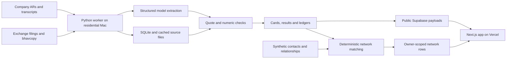

# Finn: assignment, product, code, interface and architecture audit

**Reviewed:** 12 November 2026. **Repository baseline:** `27ef311` (`README: test count`). **Live app:** https://finn-red.vercel.app. **Scope:** review and planning only; no application code, database policies, model outputs or deployed configuration changed.

This is a new independent review of the current implementation. It supplements, rather than overwrites, `docs/REVIEW-2026-11-12.md`. Several issues in that earlier review are already fixed; the findings here concern the code and website inspected during this audit.

## 1. The decision

**Finn has chosen the right kind of product for this assignment. Its immediate problem is trustworthiness and the continuity of the workflow, more than visual styling or lack of features.**

The finite daily edition, primary-source research, management-promises ledger and contextual network recommendations are a strong interpretation of the brief. Keep that direction. A large financial dashboard, a general chatbot, a graph of contacts, or more autonomous agents would consume time without solving the most important current problems.

However, the prototype is not ready to be presented as reliably verifying management delivery. A visible SBI alert opens a missing card. The live BEL ledger marks a full-year NGC promise missed using a half-year total-order figure from an analyst's question. Material filings can disappear into housekeeping after an extraction failure. User alert thresholds operate on data already filtered by different rules. These are consequential failures of the promised experience.

My recommendation is to make a narrower, demonstrably correct product before adding breadth:

1. Every visible item opens its own durable detail and source.
2. Every delivered/missed judgment compares the same metric, scope, basis, currency and period, with both sides visible. Otherwise abstain.
3. An unreadable or delayed source remains visibly unresolved; it never becomes routine merely because extraction failed.
4. User rules apply before alert candidates are discarded.
5. Push → company research → source → relevant person → useful conversation draft works as one continuous journey.

The visual identity is worth keeping. The information hierarchy and wording need work. Finn currently shows **too much low-priority explanation and repeated data, while exposing too little of the evidence needed to trust its strongest claims**.

## 2. What was actually examined

I read all pages of both supplied PDFs, including the reference glossary and category list:

- `1. ENAM_Founding AI Engineer Build Challenge_Main.pdf`: five pages.
- `2. ENAM_Build_Challenge_Reference.pdf`: three pages.

I inspected first-party worker modules, web routes and components, SQL migrations, tests, evaluation code, operational scripts, configuration and the main project documentation. The [file-by-file appendix](FINN-AUDIT-TECHNICAL-APPENDIX-2026-11-12.md) records the coverage and associated risks. Existing research documents were consulted as background; their assertions were not treated as independent proof. Third-party dependency implementations and every historical research transcript were not audited line by line.

I opened the deployed app in Chrome through Playwright and exercised the edition, weekly view, BEL and Deepak Nitrite research pages, a card, a person, settings, an uncovered ticker and search. I checked mobile at 390px, the BEL page at 320px, desktop at 1440px and dark mode. These are browser observations, not a substitute for real iPhone/Safari testing or user research.

I also used read-only local data inspection and offline reproductions. I did not submit a new coverage job, run paid extraction, send a message, deploy changes, or execute the live database write-probe evaluation.

### Verification results

| Check | Result | What it establishes |
|---|---|---|
| Worker pytest suite | **114 passed**, five PyMuPDF/SWIG deprecation warnings | Existing regression tests pass; they do not cover several reproduced pipeline and semantic failures |
| ESLint | Passed | Static lint checks |
| TypeScript, `--noEmit --incremental false` | Passed | Current static types compile; external JSON is still mostly cast rather than validated |
| Held-out classifier evaluation | Category 74/80; material 36/36; routine 35/42; two labels unknowable | Good classification baseline on this set; not end-to-end material-item recall |
| Linking evaluation, BEL | Pair precision 0.88, recall 0.70; 27 gold versus 32 predicted threads | Linking remains imperfect even before checking verdicts |
| Linking evaluation, Deepak Nitrite | Pair precision 0.75, recall 0.67; 17 gold versus 20 predicted threads | Important split/merge errors remain |
| Cached first/latest ledger quote occurrences | **1,575/1,575 normalized exact matches**, across 37 ledgers and 145 cached PDFs | Displayed quote spans exist on cited pages; does not establish that a title, value or verdict means the same thing |
| Settlement evidence objects | 54 checked; none had a source URL | Outcome provenance is not carried through to a usable citation |
| Browser console/page errors in initial page pass | None recorded | Pages render; semantic and navigation problems still exist |

No production build, Lighthouse benchmark, penetration test, full financial-statement reconciliation, live RLS deployment verification or exhaustive verdict audit was performed. Browser scripts contain deliberate waits; their elapsed milliseconds must **not** be interpreted as app performance benchmarks.

Evidence files and screenshots are in [audit-2026-11-12](audit-2026-11-12/). The principal machine-readable records are [browser observations](audit-2026-11-12/browser-observations.json), [interaction observations](audit-2026-11-12/interaction-observations.json), [offline counterexamples](audit-2026-11-12/code-reproductions.json), and [data-quality checks](audit-2026-11-12/data-quality-checks.json).

## 3. The assignment, understood from every angle

### The product it asks for

The main product is a **mobile-first investment research and relationship assistant for a lean Indian public-markets investor**. It has three integrated capabilities:

| Product capability | User's job | What a successful prototype proves |
|---|---|---|
| Push: portfolio intelligence | “Tell me what changed and deserves my attention.” | A configurable, ranked digest of real portfolio filings and unusual EOD price/volume changes |
| Pull: primary-source company research | “Help me understand this company and test its narrative.” | On-demand research that works beyond preselected examples; especially a worked last-four-quarter promises-versus-delivery analysis |
| Network: contextual relationship intelligence | “Who can help me understand or verify this, and why?” | Relevant contacts and warm paths inside Push/Pull, plus direct network questions |

An edition, a company research workspace and a contextual people layer are suitable product forms. The assignment explicitly permits different interface experiments. It does not mandate a chatbot, a native app, all optional financial-analysis menus, an autonomous trading system, or a complete terminal.

### Priority focus points, in order

This ordering is my interpretation of the assignment, not a published ENAM scoring rubric.

1. **Investor usefulness and judgment:** identify the few meaningful changes, preserve context, reduce time spent reviewing noise.
2. **One working integrated experience:** all three pillars must connect. Three polished but disconnected demos would miss the point.
3. **Evidence and financial correctness:** primary-source grounding, actual filing numbers, honest boundaries between fact, interpretation and missing evidence.
4. **Promises versus delivery:** the clearest opportunity to demonstrate useful AI beyond summarization; four quarters of traceable targets, revisions and outcomes.
5. **Network relevance:** specific person, specific reason, evidence of connection, practical question to ask. A contacts list alone is insufficient.
6. **Mobile information design:** concise first view, depth available on demand, clear interactions and manageable density.
7. **Generalization and freshness:** support an arbitrary NSE ticker when data exists; show unavailable data honestly; avoid a hand-built-only demonstration.
8. **Pragmatic architecture, efficiency and privacy:** explain pipelines, linking, caches, model choices, security, retention and deployment tradeoffs.
9. **Submission clarity:** deployed phone-friendly link, public repository, actual AI build history and a concise architectural covering note.

### Page-by-page interpretation of the main PDF

| Page | Requirement and implication | Priority |
|---|---|---|
| 1 | Build a working mobile-first prototype, public repository and cover note. Judgment and creativity matter more than completeness. The investor wants meaningful changes and hidden network insight. | Core product principle |
| 2 | Mock portfolio of 15–20 varied NSE/BSE names; roughly 3–5 additional research names; overlapping mock network. Generalize to any NSE ticker with available data. | Required demonstration scope |
| 2 | Use EOD prices/volumes, exchange announcements, annual reports/transcripts and public or synthetic professional profiles. | Data foundation |
| 2 | Default 24-hour, configurable digest; rank material filings and collapse or hide routine noise. Material event types and configurable price/volume thresholds should drive alerts. | Push foundation |
| 3 | People changes should show the newcomer and useful background/network overlap. Results should use actual filings and compare revenue, EBITDA, PBT and PAT QoQ/YoY. Material events should surface the best-placed person. | Concrete examples of end-to-end depth |
| 3 | Pull can cover business, financials, trajectory, balance sheet, cash quality, narrative versus numbers, guidance and bull/bear. These are a menu, not a demand to implement every item. | Choose useful depth |
| 3 | The especially valued worked example is promises versus delivered over the last four quarters. Research must stay within primary company documents, not brokers, news or model memory. | Highest-value Pull workflow |
| 3–4 | Network should support company expertise, suppliers/competitors, second-degree introductions, career checks, themes and warm reconnection. Integrate it quietly into research. | Distinctive product capability |
| 4 | Frontend is central; concise, elegant, interactive and mobile-first. Explain pipelines, security/privacy, models/agents, cloud and efficiency. Thin working beats broad non-working. | Delivery and engineering judgment |
| 5 | Submit deployed prototype, public GitHub, AI build history and short covering email with decisions, exclusions and next steps. | Submission requirement |

The main PDF states release **8 November 2026**, deadline **15 November 2026**. The email destination is `assessment@enam.com`, with subject **“IIT Kanpur – Founding AI Engineer - 2027”**. This audit does not send that email or publish the repository.

### What the reference PDF adds

The reference is a domain guide, not a second feature checklist. Its 17 filing categories include results, M&A, fund raising, management changes, litigation, insider trading, earnings calls, investor meetings, ratings, dividends, bonus/splits, capex, press releases, postal ballots, AGM/EGM, pledging and unclassified filings. A company-specific materiality decision must still sit above the category name. An auditor issue can be material even when a generic taxonomy treats ordinary auditor appointments as routine.

The source hierarchy matters: annual reports give audited financial and business context; quarterly filings give current numbers; transcripts provide guidance and explanations; presentations supply additional company context. One source does not replace another. A transcript quote about an outcome is evidence of what management said, not automatically independent verification from filed accounts.

The glossary helps define product semantics: revenue, EBITDA, PBT, PAT, margins, QoQ/YoY; debt and working capital; CFO/FCF; ROCE/ROE; contingent liabilities; related-party transactions; audit qualifications; promoter pledges; guidance and corporate actions. Use these definitions to avoid misleading comparisons. Do not add every ratio merely because it appears in the reference.

### Requirement-to-Finn assessment

| Requirement | Current evidence | Assessment / next action |
|---|---|---|
| 15–20 diverse holdings | 18 configured holdings | Meets numerical scope; make the holdings list discoverable |
| 3–5 ad-hoc names | Four configured: LGEINDIA, DIXON, PERSISTENT, KOKUYOCMLN | Meets configured scope; visibly demonstrate completed research for the chosen examples |
| Mock network | 29 synthetic contacts and edges; disclosure on home | Good foundation; correct second-degree ranking and failure states |
| Default 24h, selectable window | 24h/3d/7d/30d in live app | Implemented; clarify data cut-off and since-last-visit semantics |
| Ranked filings | Material leads, more items, routine counts | Good direction; extraction failures and multi-event documents can lose important information |
| Price/volume rules | Settings and in-app alerts | Partial: lossy upstream filtering, inaccessible alert rows and broken detail IDs |
| Results from filing, QoQ/YoY | Results table and arithmetic/XBRL work | Substantial; validation labels overstate some checks; source link missing at table level |
| Management bio and overlap | People cards, careers and network matching | Substantial; missing data can become false certainty about no overlap |
| Primary-source Pull | Screener discovery points to company/exchange documents | Strong boundary; freshness and document identity need explicit contracts |
| Last four quarters promises/delivery | Machine ledgers plus hand-checked BEL/Deepak references | Visually present, but semantic correctness is the biggest current gap |
| Any NSE ticker | Universe search and request queue | Architecture generalizes; robust queued/building/ready/error lifecycle and refresh are incomplete |
| Network directly queryable | Name, company and theme search | Partial; natural-language wording exceeds actual parser ability |
| One integrated workflow | Links connect edition, companies and people | Almost there; preserve originating event in notes, ensure source/detail links all work |
| Security/privacy explanation | SQL RLS separation, synthetic data, writeup | Good design intent; current deployed policy state was not independently verified |
| Cloud, efficiency, agents rationale | Local ingest + hosted UI/database; caches and routing | Defensible prototype tradeoff; operations and data versioning need strengthening |
| Submission artifacts | README/writeup/history-export tooling | Verify actual public access and history artifacts before submission; script presence is not completion |

## 4. Current architecture: keep the shape, strengthen the contracts



This is a reasonable modular monolith for a small prototype. Separation between shared public research and private relationship data is appropriate. Cached document processing and deterministic arithmetic are sensible. Keeping collection where sources are reachable is defensible if explained honestly; a consumer website loading successfully from a cloud host does not prove exchange ingestion will work from that host.

The missing layer is a **versioned, typed evidence model** between extraction and presentation. Currently JSON dictionaries carry incomplete semantics, different files become separate sources of truth, and the UI sometimes displays more certainty than the validation actually earned.

Do not rewrite into microservices. Do not add a vector database just to have one. For four transcripts, explicit document discovery, structured extraction and deterministic linking are easier to inspect. Introduce retrieval infrastructure later only when document volume and measured retrieval failures justify it. Anthropic's workflow/agent distinction supports starting with predictable, composable workflows; applying it here is an architectural judgment, not proof that one vendor or framework is universally best. [Source](https://www.anthropic.com/research/building-effective-agents).

## 5. Findings that should change the immediate plan

Severity definitions: **P0** = blocks confidence in the demonstration; **P1** = materially damages usefulness or resilience; **P2** = worthwhile improvement after the core is trustworthy. “Confirmed” means observed live or reproduced offline. “Code risk” means a reachable weakness found by inspection, without claiming it has already damaged a specific live record.

### F01 — Visible alerts can open a missing card — P0, confirmed live

The default edition showed SBI volume at 2.0×. Opening `/card/move-SBIN-2026-11-11` displayed “Nothing here.” The route searches only the 30-day edition, while the worker independently selects a different largest-price-move day for each window. A valid 24-hour card therefore need not exist in the 30-day array.

Evidence: `web/src/app/card/[id]/page.tsx:30`; `worker/src/finn_worker/cards.py:266`; [broken SBI screenshot](audit-2026-11-12/broken-sbi-alert-mobile.png). Offline comparison found seven 24h, eight 3d and nine 7d candidate IDs absent from 30d; some candidates are below current user thresholds, so those counts are not counts of visible broken links. SBI is a confirmed visible case.

**Plan:** give every event/card a durable canonical lookup independent of edition membership. Editions should reference IDs. Retain accessible detail for an explicit retention period. For the immediate patch, a complete cross-window lookup is better than 30d-only, but a canonical registry prevents the underlying error.

**Acceptance:** automatically visit every displayed card and alert in every window under several threshold settings. Every destination shows the same symbol, date and event, with its source.

### F02 — Exact quotes are being converted into incorrect ledger verdicts — P0, confirmed live and offline

The live BEL machine ledger's NGC row, `P10`, is titled **“NGC order inflow · FY27: ~₹20,000 cr”** and marked missed against 7,000. The supporting later transcript actually contains a future expectation of approximately ₹20,000 crore of NGC orders before fiscal year-end. The 7,000 figure occurs in an analyst's question about total first-half order inflow. It is not a same-period NGC outcome.

This combines several errors: old thread period versus revised target period, broad total versus specific programme, analyst question versus management actual, and premature full-year settlement. The correct immediate behavior is to withhold that missed judgment. Do not replace it with a new definitive status until target identity and evidence are checked.

Evidence: [expanded BEL screenshot](audit-2026-11-12/bel-ngc-expanded-mobile.png); `pull.py:550`, `:574`, `:704`, `:731`; the [company-filed transcript](https://www.bseindia.com/stockinfo/AnnPdfOpen.aspx?Pname=ae1ae7ce-d870-47a4-900c-c087a6e84e65.pdf), PDF pages 6 and 9. The quote-presence audit passed because a genuine quote can still support the wrong conclusion.

Offline counterexamples also produce “delivered” for:

- A USD 100 million target versus an INR 100 crore actual.
- A segment-specific target versus an actual with no scope.
- An actual structured value of 100 whose exact quote says 50.

`ground()` additionally accepts a 1,000× scaling relation without restricting it to compatible units: a synthetic 10,000% value survives against a 10% quote. These are unit/meaning bugs, not model-temperature problems.

**Plan:** introduce typed target versions and actual observations. Require entity, canonical metric, segment/programme scope, accounting basis, exact period boundaries, currency, scale, bound type, speaker role and source location. Normalize compatible scales; never collapse all money into one unit class. Numeric grounding must apply to actuals as well as targets. A revised deadline must update the active target version and settlement period. Missing scope/basis is unknown, not a wildcard.

Use explicit outcomes: delivered, missed, revised, still open, not reiterated, period ended without sufficient outcome evidence. “Not mentioned” must not imply failure. Separate management-reported actuals from verified filed figures. Preserve revisions as history rather than rewriting the original promise.

**Acceptance:** every published delivered/missed cell has comparable target and outcome evidence; incompatible or incomplete pairs abstain. Review all 54 existing settlement evidence objects, all seven latest missed rows, and the worked BEL/Deepak examples before relying on them in a demo. Expand the gold set with adversarial cases; the 1,575 quote matches do not certify 1,379 current row statuses.

### F03 — The UI hides the evidence for the outcome — P0, confirmed code/data

Settlement evidence has quote and page but no source URL. `LedgerCell` does not expose this evidence, and the expanded row renders first/latest target quotes rather than the actual quote used to settle it. A reader can inspect what was promised but cannot adequately inspect why Finn says it was delivered or missed.

`ResultsTable.tsx` also does not expose `source_url` as a direct table citation. Some move sources are labels without links. `SourceChips` caps displayed sources and the additional-count label is not a full source browser.

**Plan:** one reusable source drawer: **claim → target evidence → outcome evidence → comparison method**. Each citation needs document URL, PDF page, source date, exact span, and reported fiscal period. Add page-fragment links where supported and preserve a visible PDF page number. All sources remain reachable behind “View all sources.” For bhavcopy, link the actual daily file and explain the baseline window.

**Acceptance:** an investor can independently check any important number or verdict within two interactions. Source opening must not erase the research context.

### F04 — Failed extraction can hide a material filing as housekeeping — P0, confirmed offline

`reader.py:137–168` converts any exception into an unreadable event. `cards.py` then folds a read event with no headline into housekeeping unless it is results. A synthetic litigation filing with a timeout produced zero cards and one routine item. Because an event now exists, ordinary pending-reader selection will not retry it.

**Plan:** separate classification from extraction state. Keep the original material classification and source link. Show “Material filing received; document not yet read.” Record attempt count, failure reason, retry time and final unavailable reason. Retry temporary failures with bounds; respect explicit source refusals rather than trying to evade them.

**Acceptance:** timeout, 5xx, unsupported format, scan failure and model unavailability never silently demote a material event. A later successful retry updates the same item, not a duplicate.

### F05 — Alert rules act after information has already been lost — P0, confirmed offline

There are three independent problems:

1. `prices.py:120` exports only moves above 2% or 1.5×, while settings allow 1% and 1.2×. A 1.5%/1.3× move can satisfy the user's rules but never reach the UI.
2. `cards.py` retains the largest absolute price move per company in a window. A 6%/1.6× day can erase a 4%/8× day. A user asking for 10% price or 5× volume then receives neither, despite the volume trigger.
3. `page.tsx:186` displays only five alert rows even when the count is larger, with no complete alert-list action. The weekly view showed nine in the count.

**Plan:** preserve all bounded daily candidates for the covered companies; apply user rules first, then group related hits. A company summary may show the most important hit and “2 more matched sessions.” Give alerts stable IDs and a “View all N” action. Keep the label honest: these are currently in-app alerts; external notification delivery is a separate extension.

Map the UI's combined category toggles to every represented category (`dividend` and `bonus_split`; `insider_trading` and `pledging`). Recompute ranking consistently after preferences; do not explain a stale worker score as if it were the user's exact ranking.

**Acceptance:** every allowed threshold pair returns the expected qualifying sessions, including boundaries, volume-only spikes and multiple days per company. A count always has an accessible complete list.

### F06 — Price/filing attribution uses a filtered session calendar — P1, confirmed code/data

`cards.py:275` derives trading days from exported moves, rather than all actual market sessions. A quiet session disappears from that calendar. This can associate an older intraday filing with the wrong next-day move. The current Cochin record links a 10 November 14:27 filing to the 11 November move through this path.

**Plan:** pass the full exchange-session sequence independently of alerts. Use explicit publication time, exchange timezone and close boundaries. Separate “this filing preceded the move” from a causal explanation. Prefer “Potential context” and “No matching material filing found in the checked interval” to claiming a filing explains, or cannot explain, a market move.

Also expose baseline sample size. `moves()` averages whatever history exists; newly listed stocks may have fewer than 20 observations. A past 404 is permanently remembered as a closed day, and weekend special sessions are ignored. Treat missing data, holidays and special sessions separately.

### F07 — Results validation labels can promise checks that never ran — P0/P1, confirmed offline

A table containing only current revenue, PBT and PAT can pass `results.check()` as `arithmetic_ok` because the identities are conditional on other fields existing. The UI then says columns and totals reconciled, including half-year equals two quarters, even when those inputs were absent. An XBRL comparison can similarly return a match without enforcing a minimum set of actually compared fields.

Evidence: `results.py:295–340`; `ResultsTable.tsx:83–84`; sparse-table reproduction in the evidence JSON. This does not prove every existing results value is wrong. It proves the validation claim is too broad.

**Plan:** return structured validation results: which identities ran, which fields matched XBRL, which comparisons were unavailable, source page, basis, units and period. Require sufficient checks for each published metric. Reject conflicting columns and ungrounded labels. Owner-attributable PAT, total PAT, exceptional items, JV effects and bank layouts need explicit mappings rather than whichever combination makes an identity fit.

Quarterly tracking of full-year guidance must require the same standalone/consolidated basis; the current `tracking.py` accepts a synthetic standalone target against consolidated results. Describe a quarter as “latest quarter below target range,” not automatically “off track” for a seasonally weighted full year.

**Acceptance:** a validation badge cannot mention a check absent from its machine-readable result. Each displayed growth rate comes from compatible filed periods and bases. Unknown inputs remain blank with a reason.

### F08 — Mixed-event documents and structured people filings are not fully connected — P1, code risk

The schema supports multiple events per filing, but the results branch does not also run general event extraction. A results announcement containing a significant management change can therefore lose the second event. Grouping by company/category/day can also merge unrelated announcements.

`xbrl.parse_cim()` exists and is tested, but the main pipeline does not call it. The PDF selection and non-PDF fallback do not constitute complete XML/ZIP dispatch. Describing every non-PDF attachment as a ZIP is inaccurate.

**Plan:** identify actual document type and parse structured filings when available. Extract multiple material events from one document, each linked to its parent filing. Deduplicate by document/event identity, not simply company and day. Test results-plus-CEO-change and two distinct same-day announcements end to end.

### F09 — Freshness is represented by one timestamp when several are needed — P1, code risk

`export.py:32` anchors the edition to the latest filing timestamp. If no new filing arrives, the window and price horizon can freeze while real time advances. A successful export is not the same as a successful source refresh. `run.py` records a last cycle even when steps fail. “Since last visit” compares publication timestamps, so a newly ingested older filing or corrected extraction can be missed.

Prebuild skips existing ledger files indefinitely. Source discovery caches HTML for seven days. Normal new-transcript ingestion does not guarantee covered ledgers are refreshed. An “all four calls” heading is not proof that four appropriate quarters were found.

**Plan:** track separately: attempted/successful ingestion per provider, latest source publication, latest price session, snapshot publication time, ledger source coverage and extraction version. Compare visit cursors to ingestion/revision sequence. Refresh only affected companies when a new source or corrected document is discovered. Show partial coverage explicitly.

### F10 — On-demand research is a fragile job lifecycle — P1, code risk

Requests are imported before processing, and processed statuses are not immediately exported through the same request exchange. “Building” can be invisible remotely, while completion can wait for a later cycle. A process crash can leave a job permanently building; temporary failures can become permanent unavailable. A cached null ledger can outlive completion. Local JSON state is not a safe concurrent job queue.

**Plan:** one durable job record with atomic claim, lease expiry, attempts, heartbeat, retry time and result version. Publish status before and after work; a lightweight status endpoint can refresh the page when complete. Requeue expired leases. Distinguish no source, source blocked, retrying, budget exhausted, partial and ready. Require content-quality checks before ready.

A small Postgres jobs table is enough. Supabase's Postgres-native queue tooling offers visibility-timeout primitives if desired; consumers still need idempotency. Do not introduce Kafka for this prototype. [Source](https://supabase.com/docs/guides/queues/pgmq).

### F11 — Network wording and paths sometimes exceed their evidence — P1, live/code

The combined search works for “BEL,” a person's name and “specialty chemicals.” It does not understand “who knows TCS.” Pressing Enter navigated to `/c/WHOKNOWSTCS`, producing “No NSE equity called WHOKNOWSTCS.” The placeholder invites a richer interaction than the implementation supports.

Other weaknesses:

- The strength function awards a shared-background component merely because a contact has education data; it does not establish a shared background with the investor.
- Second-degree selection uses the investor-to-introducer strength but ignores the supplied introducer-to-target edge strength/context and picks the first qualifying path.
- Generic expertise like “order inflow” can select a civil-construction contact for a defence order, despite weaker sector fit.
- A failed private-network read becomes an empty list. People-card wording can then say nobody worked/studied with the person, rather than “network unavailable” or “no verified overlap found.”
- Multiple named appointees need individually bound overlap evidence, not one shared sentence.
- Reference-thread IDs and machine-thread IDs differ. Verifier links built for reference IDs do not automatically follow the substituted machine ledger.

**Plan:** keep one compact search entry but show explicit Company / Person / Theme intent and example chips. Implement a few supported phrases deterministically or state the supported search types. Never turn an arbitrary sentence into a ticker. Rank expertise relevance and both relationship edges; show the path and reason, not a mysterious score. Distinguish unknown, no match and unavailable.

### F12 — Publishing, persistence and privacy need operational contracts — P1/P2, code risk

The SQL has a useful public/private boundary, owner-scoped private reads and a hardening migration. The public app was not observed leaking contacts. This review does not claim a current data breach.

The weaknesses are operational: snapshot and related rows publish separately; JSON files overwrite in place; no explicit SQLite WAL/busy-timeout/foreign-key configuration; network templates are upserted without complete removal of obsolete rows; refresh copies every template to every demo owner; private fetch errors are swallowed. External payloads are mostly trusted casts. Count-based request caps are vulnerable to concurrent checks.

**Plan:** validate runtime schemas; publish a complete immutable generation then atomically advance a manifest; keep the previous valid generation. Use atomic file replacement and an explicit single-writer lock now. Add transactional counters/claims for jobs. Test RLS in an isolated database using two owners and anon access. Add a guard ensuring no private fields can enter the public export.

The existing live `evals/rls_check.py` performs write probes, including a public snapshot mutation attempt. If a policy regresses, that test can alter live data. Move these probes to staging or disposable fixtures rather than running them against the demonstration.

Anonymous-auth rate limiting also deserves a clean-session load check. Supabase documents a default 30 anonymous sign-ins per hour per IP; the actual project's settings were not inspected. Server-originated signup can concentrate requests. Preserve existing sessions and implement the supported signup/IP-forwarding approach if this is reproduced; do not put a service credential in the browser. [Source](https://supabase.com/docs/guides/auth/auth-anonymous).

## 6. The interface: what to keep, simplify, add and remove

### Overall judgment

The off-white paper palette, restrained serif headings, compact numeric typography, thin dividers and quiet blue people links create a coherent editorial product. Dark mode preserves the same hierarchy. The checked pages did not horizontally overflow at 390px, and the ledger fitted 320px.

The UI is not a visual mess. It becomes difficult because the user must infer what labels mean, discover hidden depth and distinguish several kinds of uncertainty. The largest usability gains will come from clearer states and a better first screen, not more gradients, illustrations or animation.

No design can honestly be called “the best possible UI” from one review. The proposed changes should be tested against concrete investor tasks.

### Edition: a concise decision surface

The live default view combines **3 alerts**, **NOTHING MATERIAL**, and **7 worth a look**. This is internally confusing. “No lead selected” is not the same as “nothing material.” The voice briefing should use the same distinction and include relevant alerts.

Recommended first screen:

```text
FINN                              Wed 11 Nov
18 holdings · updated 19:00 IST    Data status

[24 hours] [3 days] [7 days] [30 days]

3 rule matches                    View all
Price / volume · checked at market close

Today’s priorities
No lead story in this window.
7 other updates worth reviewing.

[Compact update]
Company · event · time
One sentence explaining the change
Revenue +26.5% YoY · PAT +19.6%   (if relevant)
Who can help: Harish · former BEL advisor
Details and sources →

7 other updates                   Review
11 routine filings                Browse

[Company, person or theme…]
```

These are proposed copy/layout examples, not newly verified investment statements. The exact metrics must come from validated data.

Keep a finite edition. Show a few meaningful items, then a deliberate “Review remaining N.” Expanding the weekly view produced roughly 5,937px of document height. Do not require users to traverse every full results table to reach the next meaningful event. Put a two-metric summary on the card and the full table in detail.

Move technical ranking arithmetic out of the main detail flow. “Large holding; material management change; filed today” explains attention better than +300/+55/age coefficients. The calculation can remain under methodology for reviewers.

Make routine/muted filings retrievable as actual records with titles, times and sources. The brief allows routine items to be hidden, so this is a trust/discoverability improvement rather than a demand to put all filings on the home screen.

### Company research: prioritize questions, not modules

The BEL page leads with a generic business sentence and a long segment list, then benchmark explanations and a dense ledger. The important research question should arrive sooner.

Suggested order:

1. Company identity, holding weight if applicable, latest close and data coverage.
2. A useful two-sentence business explanation: what is sold, to whom, and principal business drivers, only when supported by source.
3. **What changed / What needs checking:** at most three evidence-backed observations.
4. Promises versus delivery summary, with the few changed/due/unresolved promises first.
5. Latest results summary and expandable complete table.
6. Relevant people, connected to the questions above.
7. All filings and source coverage.

Do not force all these into permanent tabs immediately. In-page anchors can preserve orientation on mobile. A desktop version can use an 840–1040px workspace with an evidence pane; the currently measured content width was about 448px inside a 1440px viewport. That is a later enhancement because the assignment is mobile-first.

### Promises ledger: summarize, then reveal the matrix

BEL currently has 71 machine rows, 53 too early. The glyph-heavy four-column grid is useful for an analyst comparing history, but demanding as the first research view. It also foregrounds implementation benchmarking (“Built by FINN” versus reference) before the investor's question.

Recommended default:

```text
Promises vs delivery
4 calls reviewed · source coverage →

Needs attention (validated count)
[Promise name]                     Revised / Open / Missed
Original target → current target
What changed, in one sentence
Latest comparable evidence, or “Outcome not established”
Evidence →    Who can help verify →

[All promises] [History matrix] [Methodology]
```

Use visible status words with icons; colour is supplementary. Separate “deadline moved” from “numeric target changed.” “Period ended, no outcome evidence” should not look like “missed.” Explicitly show fiscal quarter and call date. Do not turn 71 extracted rows into a management credibility score.

Keep the hand-checked reference as a transparent methodology/evaluation view, not a prominent competing truth on the main research screen. The reference remains valuable for assessing the system. The product should never quietly present hand-labelled results as model generalization.

### People and conversation drafts

Lead the person page with why this person is relevant **to this event**, what question they might help answer, and the evidence of their connection. Follow with the warm path and recency. Career history is supporting detail. Raw scoring formula is methodology.

Pass the originating event or promise ID through links. Today a draft can choose the latest company card instead of the event that motivated the click. A useful draft should preserve the investor's question, avoid inserting unsupported claims and be editable. Clipboard success should only appear after copying succeeds. No automatic outreach is needed for the assignment.

Use wording like “Worked at the same company during overlapping dates” when that is all the evidence establishes; it does not prove the two people personally worked together. Keep the synthetic-data label visible but unobtrusive.

### Search and navigation

Shorten the clipped placeholder to **“Company, person or theme”**. Show examples on focus: BEL; specialty chemicals; Rhea. Group results by type and label weak theme matches as such. Add loading, empty and failure states. Enter should select an explicit result or show suggestions, not manufacture an NSE symbol from the full sentence.

Keyboard users need predictable arrow navigation, Escape dismissal, focus restoration and accessible combobox semantics. If tabs use ARIA tab roles, implement corresponding keyboard behavior and panel relationships. Preserve list scroll, selected window and expanded state when returning from detail.

The fixed dock is useful for reachability, but it occupies significant phone space. Check the software keyboard, safe-area inset and focused content on actual iOS Safari. Full-page screenshots draw a fixed dock at its current viewport position; that screenshot effect alone is not evidence of a layout defect.

### Accessibility and smoothness

Use comfortable approximately 44px primary tap areas, readable body text, visible keyboard focus and labels that do not depend on colour. Do not claim that every control smaller than 44px violates WCAG: WCAG 2.2 AA's target-size criterion uses 24px with spacing and other exceptions. [Source](https://www.w3.org/WAI/WCAG22/Understanding/target-size-minimum).

Measure actual mobile loading and interaction performance before optimizing. Suggested targets, not current measurements: useful cached edition within about two seconds on a representative mobile connection; immediate local focus/selection feedback; explicit status for any background research; no layout shift that moves the row being tapped. Test slower networks, expired sessions, unavailable private network and stale public data.

Voice should be optional and secondary. “Brief me · 60s” should reflect actual generated duration or become “Listen to brief.” Add speech-error and unsupported-browser behavior. Do not let voice embellish a thin edition or omit alerts while saying nothing happened.

### Components to add or change

| Change | Why | Priority |
|---|---|---|
| Durable event detail and complete source drawer | Trust and navigation | P0 |
| Target-versus-outcome evidence panel | Verify the signature feature | P0 |
| Complete alert list and matched-rule explanation | Make settings meaningful | P0 |
| Data freshness/coverage indicator | Distinguish quiet market from stale/broken ingestion | P1 |
| Material-but-unreadable item state | Prevent silent losses | P0 |
| Research job progress/retry state | Make arbitrary-ticker Pull usable | P1 |
| Compact results summary with expandable full table | Reduce home-feed density | P1 |
| Promise attention list plus optional history matrix | Reduce interpretation cost | P1 |
| Explicit company/person/theme search | Match the interface promise to capability | P1 |
| Routine filing browser | Make collapsed information recoverable | P1 |
| Discoverable holdings and research examples | Explain portfolio context and demonstrate breadth | P1 |
| Context-preserving, editable conversation draft | Complete the network workflow | P1 |
| Small upcoming results/guidance-deadline strip | Help an investor prepare; only with reliable dates | P2 |
| Cash/debt/working-capital research section | High-value Pull depth after filed data is dependable | P2 |
| Save a question/claim to follow next quarter | Creates useful continuity | P2 |

### Components to remove, demote or avoid

- Demote long reconciliation formulas and raw ranking scores to methodology.
- Demote benchmark/reference explanations from the first company screen.
- Collapse repeated full financial tables and generic business/segment lists.
- Replace “nothing material” when meaningful rule hits or updates are present.
- Replace unexplained symbol-only statuses with readable labels.
- Remove misleading additional-source counts that cannot be opened.
- Avoid a portfolio P&L terminal, candlestick workspace, broad news feed, contact graph, stock recommendations, opaque credibility scores and an unrestricted chat-first homepage before the core workflow is correct.

## 7. What existing products do better, and what to borrow

This comparison uses current official product/help pages, not paid-account hands-on testing. “Better” here means a documented capability or interaction that addresses an observed Finn gap. It is not a measured accuracy, latency, coverage or investment-performance ranking.

| Product | Documented strength | Finn gap it helps address | Specific adaptation |
|---|---|---|---|
| Screener | Company analysis, peer comparisons, fundamental charts, segment results, alerts, insights and AI summaries | Pull is thin beyond the ledger; company pages do not yet give enough financial context | Add a concise validated financial spine and coverage states before more narrative. [Official features](https://www.screener.in/premium/?driver=top-nav-tools) |
| Tijori | Portfolio-specific timeline, filings/business updates, price-volume alerts and results access | Edition needs complete event navigation and contextual business detail | Borrow event grouping and company context; keep Finn's primary-source research boundary rather than importing every content type. [Official dashboard](https://www.tijorifinance.com/dashboard/) |
| Trendlyne | Portfolio timeline/calendar and configurable price/volume alert intervals | Alerts and upcoming event visibility are incomplete | Make rule scope, full matched list and next known event explicit. [Official portfolio features](https://trendlyne.com/portfolio/all-features/) |
| Quartr | Save exact transcript passages, reopen their context, synchronize highlights across mobile/desktop | Finn's quote exists, but verifying and revisiting it is awkward | Claim-level source opening and saved evidence; eventually track a promise from its exact passage. [Official transcript highlighting](https://quartr.com/features/transcript-highlighting) |
| AlphaSense | Research scope controls and cited answers that let the reader inspect supporting material | Finn needs stronger claim-to-source and target-to-outcome traceability | Copy source inspection and explicit research scope, not its broader broker/news/expert content mix. [Official Generative Search guide](https://help.alpha-sense.com/hc/en-us/articles/41666587181203-Interacting-with-Generative-Search) |
| Koyfin | Configurable triggers, watchlist/portfolio scope, alert management and desktop/email/mobile delivery | Finn conflates rule-matched rows with a full alert product | Show rules and complete hit history now; add an opt-in delivery channel later. [Official alerts](https://www.koyfin.com/features/alerts/) |
| Affinity | Introduction paths and relationship indicators based on interaction recency/frequency | Finn's second-degree path and shared-background score are weak | Explain both edges of an introduction and their freshness; retain human-readable reasoning. [Official relationship intelligence](https://www.affinity.co/product/relationship-intelligence) |

The README's claim that every Indian tool sends one ping per filing needs narrower evidence. Trendlyne's global analyst guide documents a single daily/weekly summary for its superstar-investor alerts. That is not proof of an identical ranked filing edition, but it shows why broad claims that competitors only send individual pings are unsafe. Describe Finn's actual design distinction instead of asserting an unverified market absence. [Official analyst guide](https://faq.trendlyne.com/support/solutions/articles/84000392167).

A credible positioning statement would be: **“A short, source-linked edition for your portfolio, with a traceable record of management commitments and the people who can help you investigate.”** The distinctive opportunity is the combination. Existing finance products already cover many of its individual features.

## 8. Data and database plan

### Canonical records

Do not normalize every JSON field before the deadline. Introduce the concepts that prevent current errors, then migrate incrementally.

| Record | Essential fields / invariants |
|---|---|
| Company/security | Stable company/security identity, NSE/BSE identifiers and aliases; ticker is a lookup label that can change |
| Source document | ID, origin URL, hash/version, company, type, published/ingested times, reporting period, fetch state, content type |
| Evidence span | Document/version ID, PDF page, exact quote, optional coordinates, speaker and role |
| Extracted event | Stable ID, parent document, event kind, effective time, classification, extraction state, evidence IDs |
| Financial observation | Metric, value, unit/scale/currency, period start/end, standalone/consolidated scope, source cell, validation results |
| Promise | Stable thread ID, canonical metric/scope and original evidence |
| Promise version | Target, bound, conditions, basis, due period, version date, superseded version, evidence |
| Outcome comparison | Target version, compatible actual observation, rule version, verdict, reason, abstention reason |
| Edition | Generation, window boundaries, ordered event IDs, routing/ranking reasons; no independent duplicate event identity |
| Alert hit | Rule version, event/session ID, matching values, state; uniqueness prevents duplicate notifications |
| Research job | Ticker, source fingerprint, state, lease, attempts, next retry, output generation and reason |
| Relationship edge | Owner, parties, evidence/context, relationship type, recency, strength basis and consent/source provenance |

Use decimal-safe handling where arithmetic precision matters; represent units explicitly. Keep source values and normalized values separate. A number called “100” without currency, scale, basis and period is not a usable financial fact.

### Publication and read model

A compact snapshot is useful for fast mobile rendering. Keep it as a derived read model, not the only source of event identity. Build `generation N`, validate its schema and referential completeness, upload its constituent records, then atomically switch the current manifest. Readers use one generation consistently. Retain the previous valid generation for rollback.

Private network responses should have explicit status and belong to the current owner. A network failure must not block public market research, but it must not appear to be a factual “no contacts” result either. Never share-cache a merged private view.

### Refresh and provenance

Refresh research when source fingerprints change, not simply when a filename is absent. Invalidate cached derivations on extraction schema, model, prompt, parser or status-rule changes. Record provenance in the result so a reviewer can reproduce how it was built.

Model cache keys should include task version, schema, source hashes and actual model/provider identity. Dynamic fallback selection without provenance makes evaluation unstable. Reserve budget before work and cap response size/attempts; the current prior-spend check is not a hard concurrent budget ceiling. Distinguish public company documents from private investor contact data in the writeup; “names appear in a document” is not a complete privacy classification.

## 9. Execution plan

This is a proposed implementation sequence, not work performed in this audit. Effort estimates are planning ranges for one developer familiar with the repository. The full robust backlog exceeds the remaining submission window; do not interpret it as a promise that all items fit in three days.

### Stage A: establish a trustworthy demonstration

| Order | Work package | Indicative effort | Dependencies / done condition |
|---|---|---|---|
| 1 | Canonical card lookup; every visible link tested | 2–4 hours | All windows and alerts open matching details |
| 2 | Suppress unsupported ledger verdicts; fix evidence payload/rendering; inspect the two worked examples | 1–2 days | No known false delivered/missed judgment in demo; both sides cited; unknowns explicit |
| 3 | Keep unreadable material filings visible; bounded retry state | 3–5 hours | Failure injection preserves material item and source |
| 4 | Preserve alert candidates; apply rules before grouping; show all hits | 4–6 hours | Boundary/volume/multi-day cases pass |
| 5 | Honest results validation and same-basis tracking | 4–8 hours | Badge states only checks performed; sparse or incompatible data cannot claim reconciliation |
| 6 | Data state, network failure state, safe search fallback, contextual note | 4–6 hours | Clean mobile journey with no invalid sentence-as-ticker navigation |
| 7 | Compact feed, clearer ledger summary and evidence drawer polish | 4–8 hours | Investor can find and verify the top question without reading a long technical explanation |
| 8 | Refresh submission facts and rehearse real paths | 3–5 hours | Public access verified, history attached, measured claims and limitations consistent |

The durable typed ledger engine is larger than a cosmetic patch. Under a hard deadline, publish fewer well-supported judgments and retain unresolved rows with evidence. A hand-checked worked example may be shown transparently as a reference, while the general machine pipeline exposes its limitations. That demonstrates judgment more credibly than false certainty across dozens of tickers.

### Suggested 12–15 November calendar

**12 November:** fix navigation and alert completeness; add semantic counterexamples; remove known invalid verdicts from the proposed publication set; establish target/outcome evidence records.

**13 November:** validate BEL and Deepak end to end; correct validation labels and unreadable-material behavior; ensure one arbitrary-ticker request can move through its states; add truthful freshness/network state.

**14 November:** refine the home/ledger/search journey, test on an actual phone, inspect private/public boundaries in staging, refresh README/writeup and prepare actual build-history artifacts. Freeze new feature scope.

**15 November:** verify deployed links, sources, empty/error states and a fresh session; keep time for defects and submission. The PDF gives the date but no cutoff time in the inspected text, so do not assume a late-night deadline.

If time runs short, cut new financial sections, broad prebuild expansion, external push delivery, desktop redesign and voice enhancements before cutting correctness or source access.

### Stage B: stabilize after the assignment

1. Replace local request JSON with leased durable jobs and atomic rate/budget reservations.
2. Publish versioned snapshots with schema validation and rollback.
3. Add transcript-triggered research refresh, document correction detection and per-provider freshness monitoring.
4. Harden full financial extraction, mixed-event filings and structured management changes.
5. Expand semantic evaluation across sectors, reporting bases, units, currencies and deadline revisions.
6. Improve relationship paths, provenance, ownership and private-data lifecycle.
7. Add saved research questions, upcoming milestones and one useful financial-depth section at a time.

### Stage C: grow only after measured usage

Add richer retrieval, notifications, cross-company research or a desktop evidence workspace only after observing repeated user tasks. Consider a permitted, reliable data provider when source availability becomes the limiting factor. Keep the provider behind an interface, with attribution and freshness preserved. Do not move ingestion to another host until a reachability probe demonstrates that the required sources work there.

## 10. Acceptance tests that matter

The current tests are useful, but passing them did not prevent live broken navigation or wrong semantic conclusions. Add tests at the boundaries where data changes meaning.

| Test family | Required cases |
|---|---|
| Navigation contract | Every displayed card/alert across 24h/3d/7d/30d resolves; back preserves window and context |
| Alert completeness | Minimum thresholds, exact boundaries, volume-only hit, two sessions for same company, muted category aliases, all counted hits reachable |
| Filing survival | Timeout/scan/XML/ZIP/model failure retains material classification; retry updates same item; mixed results-and-management document emits both events |
| Ledger identity | Same word different segment, same programme different FY, H1→FY deadline extension, Q2→Q4 extension, changed condition, repeated same-call statement |
| Ledger settlement | INR versus USD, crore versus million, percent versus basis points, actual number absent from quote, analyst question, unknown scope, standalone versus consolidated, pending full year |
| Citation contract | Every verdict has target and outcome URL/page; page correction retained; quote span and displayed value consistent |
| Results | Sparse inputs, zero compared XBRL fields, NCI/owners PAT, exceptional sign, bank layout, lost comparative column, loss-to-profit, missing prior period |
| Refresh/jobs | Crash after claim, retryable provider failure, duplicate request, concurrent quota, new transcript, source correction, ready result after cached null |
| Privacy | Two owners, anon, expired session, public export has no private fields, database error differs from empty network |
| Mobile | 320/390px, iOS keyboard, focus/escape, target sizes, dark mode, loading/empty/stale/partial/offline states |

Proposed release gates: zero unresolved broken links in tested windows; zero known false settled verdicts in the demonstration; 100% of settled demonstration rows have comparable outcome evidence; no swallowed material item under failure injection; all claimed tests/coverage metrics are reproducible. These are proposed gates, not current achievements.

A useful five-task user session: identify today's most important change; change a price rule and explain its effect; verify a ledger judgment; find a person who can answer a specific company question; request research for an uncovered ticker and understand what happens next. Observe success and hesitation rather than asking whether the design “looks good.”

## 11. Submission and narrative corrections

The repository already contains thoughtful decisions, research experiments and a stronger-than-average explanation of tradeoffs. Bring the public narrative into alignment with current evidence:

- State exactly how many companies have useful completed research and how many have partial/missing source coverage. The local snapshot had 37 ledgers and 31 business snapshots, not proof of complete Nifty 50 coverage.
- Timestamp cost and call counts. Local logs contained 1,430 model calls and roughly $2.18 recorded cost during this audit; older writeup figures can remain historical if clearly dated. This is not a full provider billing reconciliation.
- Report quote fidelity separately from extraction recall, thread linking and verdict correctness. “Quotes verified” cannot stand in for “analysis verified.”
- Explain that the network is synthetic and how real private data would be isolated, consented, retained and deleted.
- Describe the residential ingestion dependency and recovery plan honestly. Include last successful fetch/worker health in operations, not just website uptime.
- Distinguish in-app rule matches from delivered push/email notifications.
- Describe why a fixed extraction-and-verification pipeline was selected; do not invent an agent architecture to satisfy a perceived buzzword requirement.
- Verify the actual public repository and actual AI session exports/share links from a clean browser. An export script alone does not meet the build-history requirement.
- Keep the covering email short: the investor problem, what works, the strongest worked example, the deliberate exclusions, architecture tradeoffs and next step. Link the deeper writeup.

The product should leave a reviewer with one convincing experience: **“I saw a meaningful change, understood the evidence, checked the company's earlier promise, and knew whom to ask next.”** That is the standard the remaining work should serve.
